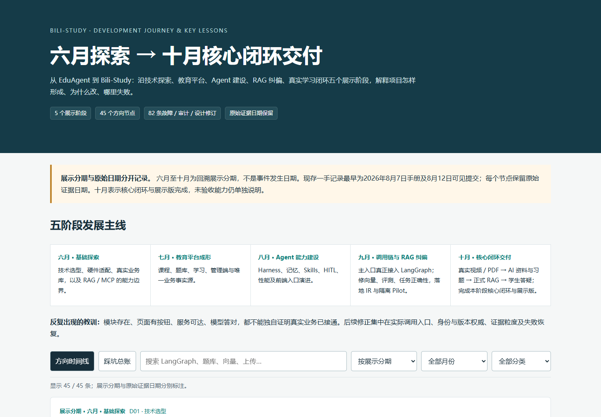

<h1 align="center">Bili-Study</h1>

<p align="center">真实Bilibili视频 → AI 学习资料与习题 → 带来源的课程答疑。</p>

Bili-Study 是面向学生、教师和课程管理员的 AI 学习系统。管理员导入本地视频、Bilibili 链接或 PDF；学生看课、读笔记、按章节回看、做相关练习，并向 Course Tutor 提问。

**技术核心：FastAPI / Python · Next.js / React · LangGraph / Harness · BGE-M3 / Milvus · MinerU / Neo4j · OpenTelemetry / Jaeger。**

<!-- BILI-STUDY-HISTORY:START -->
## **DEVELOPMENT JOURNEY & KEY LESSONS｜开发历程与关键踩坑**

### **建立1,720份文档与记录索引，结合864条可见Git记录**

### **[完整交互网页源码与下载](docs/history/index.html)**



> **上图为真实HTML页面预览。** GitHub README不执行HTML；点击上方加粗入口，下载HTML后即可在本地搜索、筛选和查看完整记录，单个HTML即可运行。

**六月探索 → 七月平台成形 → 八月 Agent 建设 → 九月 RAG 纠偏 → 十月核心闭环与展示版交付。**

> **时间口径：六月至十月为回溯展示分期，不是事件发生日期。** 主条目按阶段显示日期，真实证据日期保留在下方溯源详情中。**十月交付指本阶段核心闭环与展示版完成，不代表全部能力和部署均已验收。**

| 展示阶段 | 演进重点 |
|---|---|
| **六月 · 基础探索** | 技术选型、硬件适配、真实业务库，以及 RAG / MCP 的能力边界。 |
| **七月 · 教育平台成形** | 课程、题库、学习、管理端与唯一业务事实源。 |
| **八月 · Agent 能力建设** | Harness、记忆、Skills、HITL、性能及前端入口演进。 |
| **九月 · 调用链与 RAG 纠偏** | 主入口真正接入 LangGraph；修向量、评测、任务正确性，落地 IR 与隔离 Pilot。 |
| **十月 · 核心闭环交付** | 真实视频 / PDF → AI 资料与习题 → 正式 RAG → 学生答疑；完成本阶段核心闭环与展示版。 |

**关键转折：** 从大量合成课程转向真实视频 / PDF 学习；从“有模块”转向真实调用链；从“向量已入库”转向 **READY publication 才是学生正式视频知识权威**。

**主要教训：** 管理题库与学生题库曾是两套事实源；常用SSE曾绕过LangGraph；记忆曾只入队无人消费；错误Mock与金标粒度曾制造假绿；首次pending视频曾泄漏3条Tutor证据；依赖在线、工具成功和整轮回答成功必须分开验证。

<details>
<summary><strong>展开完整45个方向节点（阶段展示日期；原始日期见溯源）</strong></summary>

### 六月 · 基础探索

- **D01 · 理想技术栈 → 适配真实机器**（阶段展示日期：2026-06-07；文内日期）
  本机 Docker / ES / vLLM 方案改为 Windows Python 3.11、虚拟机存储、轻量 BM25、云模型。8GB GPU 与既有服务决定选型，而不是按名词堆架构。
- **D02 · 虚构数仓 → 66 表真实 OLTP**（阶段展示日期：2026-06-07；手册陈述）
  发现 fact_enrollment、dim_course 等设计表不存在，改在真实业务库建立只读分析视图，并明确软删除、订单支付口径。
- **D03 · 基础问答 → 混合 RAG**（阶段展示日期：2026-06-08；设计/实现说明）
  早期手册已有多通道、RRF、重排、截断与租户设计；这证明设计起点，不证明所有通道后来一直工作。
- **D04 · 明确 MCP 最小实现与协议边界**（阶段展示日期：2026-06-09；手册边界）
  采用可控传输、注册、审计、调试；当时所谓 SSE 仍是 POST 占位，不是完整标准协议能力。
- **D05 · 默认异常 → 统一错误体与真实登录 E2E**（阶段展示日期：2026-06-09；历史 E2E）
  补 HTTP/422 handler、表单错误与禁用账号提示；当时 TS 历史错误仍在。后来又修订 403 不应登出。

### 七月 · 教育平台成形

- **D06 · 技术样例 → 一体化教育平台**（阶段展示日期：2026-07-12；PRD + Git）
  选课、学习、练习、错题、推荐、成就、社区、管理、RAG、MCP 被纳入；PRD 自述前端约45%、管理端0%，后端端点齐不等于产品完成。
- **D07 · 单轨顺序 → 前端/管理端/后端并行**（阶段展示日期：2026-07-12—13；历史变更记录）
  围绕实际缺口统一壳与接口，逐步接真实数据；并行提高速度，也埋下共享工作树与契约漂移风险。
- **D08 · 检索后模板拒答 → 意图决定检索/工具**（阶段展示日期：2026-07-14；代码提交）
  新增真实 Agent flow：闲聊、知识、工具按需处理，再交模型回答。Agent 并非9月才出现。
- **D09 · 开发样例 → 生产护栏与运维**（阶段展示日期：2026-07-14—15；代码/变更记录）
  安全、CI、部署、日志、指标、错误码、性能、Alembic逐项进入；Milvus延迟、SSR重复请求等仍挂账。
- **D10 · 平行管理表 → 既有正式业务域**（阶段展示日期：2026-07-15—18；历史故障 + Git）
  发现管理题库18行与正式10512行断开，回归已有主表；先备份恢复演练，再移除当时的11张平行表。此历史动作不是今天删除数据的授权。

### 八月 · Agent 能力建设

- **D11 · 单问答循环 → 生产 Agent 治理**（原始证据：2026-08-27—29；提交与后续审计）
  Skills、动态压缩、上下文编辑、前缀缓存、记忆事件、并发预算、工具熔断、HITL、影子评估陆续加入。后续审计证明部分首版还缺活跃 caller。
- **D12 · 形式 Harness 接口 → 核心逻辑真正迁入**（原始证据：2026-08-28—29；代码提交）
  先有注册接口，再把 route/plan/fan_out/merge/reflect/answer 六核心实现搬入 SixNodeHarness；Graph 保留编排。九节点和六节点不是两套竞争主流程。
- **D13 · 多次串行 LLM → 规则快路径与有界预算**（原始证据：2026-08-29；提交/历史测量）
  主链5次串行降到3次，子代理预算缩小，规则分流与知识直检减少不必要调用；流式与非流式验收口径分开。
- **D14 · 重复原始知识 → 权威源幂等切片**（原始证据：2026-08-30；历史导入记录）
  从 seeds 生成2628片，统一公共课程/题目双向量、断点续跑；云批量上限触发本地 BGE-M3 CUDA。此时 Neo4j 仍为0/待重建。
- **D15 · 短期 Redis 状态 → MySQL任务与对象留存**（原始证据：2026-08-30；代码提交）
  导入状态加入持久层，文件进入 MinIO，逐步补任务查询、生命周期与流式上传。
- **D16 · React → 静态HTML → React恢复 → 静态真API**（原始证据：2026-08-30—31；连续反向提交）
  入口因登录跳转、AI发帖与交互问题反复；最终共享 edu-api.js、根页跳登录，React路由仍保留。不能写成一次平顺重构。

### 九月 · 调用链与 RAG 纠偏

- **D17 · 页面原型 → 真实课程/练习/管理接口**（原始证据：2026-09-02—04；代码提交）
  学生练习改服务端判分；管理页增加三段守卫；DTO、snake_case、分页、SSE契约逐渐统一。部分媒体状态当时仅代码测试。
- **D18 · Redis/OTel 名词 → 真实跨实例验证**（原始证据：2026-09-04—05；代码提交）
  验证真实 Redis、锁、缓存幂等与采集端；此时 OTel 仅证明 HTTP 投递，尚不能称 Jaeger 原生瀑布已完成。
- **D19 · 开发宽松 → DEBUG与身份生产硬门**（原始证据：2026-09-12—13；代码提交）
  生产鉴权、错误脱敏、JWT轮换、refresh单次消费、checkpoint HMAC、代码子进程隔离。子进程不等于容器沙箱，历史降级也有取舍。
- **D20 · 功能清单已齐 → 真实调用链审计**（原始证据：2026-09-13—14；两份审计）
  两份审计分别列23、26项问题；先测量、双跑、迁移，再改核心。最重要发现是文件存在、页面有入口和主路实际调用完全不同。
- **D21 · SSE旁路 → graph.astream 真入图**（原始证据：2026-09-15；审计 + 修复提交）
  旧常用流式接口是普通Python流程，九节点只在另一路。切换后保留五事件、回滚开关、线程隔离与真实检索文档。
- **D22 · 声明/队列 → 真实执行与恢复**（原始证据：2026-09-15—22；代码提交/反例）
  补 memory consumer、MCP参数/查找/backend接线、default-deny；HITL多轮修复后才有真实暂停确认恢复，不是一轮框架提交即全通。
- **D23 · 脆弱chunk身份/混合embedding → 唯一身份与VEC-LOCK**（原始证据：2026-09-15—16；审计/代码提交）
  tenant+canonical hash+seq 防覆盖；查询写入同源编码器。历史只读对账发现1636异模型块、142空文本。RAG禁伪向量与记忆域可用性降级必须分清。
- **D24 · 调算法 → 先校准金标粒度与通道健康**（原始证据：2026-09-19；代码/评测结论）
  导航卡金标不适合内容问句，改内容块评测；0.9844不能冒充同尺算法巨幅提升。总命中率也不能掩盖dense通道全死。
- **D25 · GraphRAG概念 → 灰度第四通道**（原始证据：2026-09-19；历史双跑）
  2-hop候选经RRF，验证黑洞降级；双跑0.9688对0.9688，零增益，保留默认关闭。图接入不等于证明效果更好。
- **D26 · 自动看门狗/表面记忆 → 真实根因修复**（原始证据：2026-09-19—24；代码提交）
  撤回误杀慢实例的watchdog；修BGE fp16 NaN、记忆抽取/旧HEAD/降级读写不对称、反馈条重绘消失等。
- **D27 · 自制HTTP事件 → 原生OTLP/Jaeger**（原始证据：2026-09-24；代码提交）
  原生trace瀑布与层级span进入；Neo4j推荐有来源标记与停机降级。与9月初采集端验收是两个阶段。
- **D28 · 技术栈补丁 → 企业RAG八波架构**（原始证据：2026-09-25；PRD转向）
  明确 SourceAsset→Parser→IR→Chunk→BGE→过滤→融合/重排→回答/评测；要求技术都有活跃caller。八波是计划，不等于全部实施。
- **D29 · v2 → v2.1/v2.2**（原始证据：2026-09-25；设计修订，非全量验收）
  放弃无ACK的TaskQueue做跨进程主队列；选择Streams + MySQL CAS/epoch/lease/fencing。纠正exactly-once假设、长MinerU任务误回收、评测副作用与图失败补偿。
- **D30 · v2.3 → v2.4/v2.5 → 停止加文档**（原始证据：2026-09-25—26；连续PRD修订）
  补入口/状态/数据/L1-L3证据、generation authority、ImportCommand、责任矩阵和影响扫描；六轮后停止v2.6转施工。旧通用重导策略不能套成当前视频不中断旧ready的策略。
- **D31 · 方向通过 → 执行护栏与IR实际实施**（原始证据：2026-09-26—27；验收/代码）
  G0方向PASS但enforcement曾FAIL；W0修假配置与回滚，W2验证IR provenance；W3提交不能单独证明MinerU全部生产终态。
- **D32 · 全平台大改 → 单课隔离Pilot**（原始证据：2026-09-27—28；正式范围决策）
  分库/分namespace，Neo4j Community不支持所需独立库所以隔离试点禁用；技术启动PASS，G1学生闭环仍PARTIAL，历史决策NO PILOT。

### 十月 · 核心闭环交付

- **D33 · 大量合成课程 → 真实精选课与Video Compiler**（原始证据：2026-10-04；V0验收与产品决策）
  保留现有RAG，把真实视频→字幕→笔记/章节/导图→学习页→Tutor作为主线；课程命名忠于LeetCode精讲，不包装成完整系统课程。
- **D34 · 一个P1演示 → P1/P3/P26可复用能力**（原始证据：2026-10-04；独立验收记录）
  V0单课单视频后，第二个native与显式真实ASR复用统一合同；ACCEPT_SCOPED不代表30P、全课程或天然无字幕自动路径当日全验收。
- **D35 · 脚本替运营 → 原管理页生产闭环**（原始证据：2026-10-04；有界真实验收）
  本地上传、已有绑定视频重编、Bilibili均复用正式task API；支持状态、预览、版本审核、重试、发布和既有RAG。保留原视频与旧正式版本。
- **D36 · Milvus active → READY publication唯一正式权威**（原始证据：2026-10-05；真实RED→GREEN→恢复）
  首次pending向量已active时曾泄漏3条Tutor文档；修SQL READY authority与ANN前精确video/generation/SHA过滤，兼容普通课程知识。
- **D37 · 人工等待审核 → 成功自动发布入库**（原始证据：2026-10-05；用户选择 + 实现记录）
  Owner明确选择省去人工审核；保持租约、任务creator、当前artifact SHA/generation精确批准，旧审核API保留历史兼容。资料发布和RAG ready仍分阶段真实报告。
- **D38 · 选定Golden源 → 三类别真实页面导入**（原始证据：2026-10-06；真实页面与产物记录）
  Python、Agent记忆、RAG三条实际链接通过原页面生产；原生861段，短英文ASR43段，长RAG ASR1742段。非全分P。修下载分块、语言持久化、AV1播放兼容及摘要预算。
- **D39 · 笔记式折叠导图 → 节点图与对应习题**（原始证据：2026-10-07；学习闭环记录）
  独立节点/边/展开/时间跳转；新增视频习题接既有题库、判分、错题本，以视频/generation/SHA绑定，模型只能选服务端校验的字幕窗口。
- **D40 · 装有依赖 → 新PDF/视频真正经过解析/图谱/trace**（原始证据：2026-10-07；真实接线与验收）
  PDF走MinerU→IR→既有RAG；视频READY后投影Neo4j且图失败不撤销READY。补worker心跳/drain及跨进程OTel。基础PDF/OCR已验，不泛称复杂表格公式全通。
- **D41 · EduAgent → Bili-Study；源码展示与私有历史分离**（原始证据：2026-10-07—10；归档清单/现有说明）
  源码目录改名保留Edu数据标识，原件外置归档；GitHub展示强调架构/技术/核心能力。source发布不等于完整跨机部署验收，现有业务库与媒体不公开。
- **D42 · 只开应用 → 全技术栈编排与真实ready**（原始证据：2026-10-10；运维验收入口；具体批次见归档）
  Redis/VM/容器/Worker/MinerU/Neo4j/Jaeger缺失或错误健康判定暴露；正式脚本应区分应用/依赖、预热、失败退出与drain，不能用端口可达宣称全栈ready。
- **D43 · 旧本地服务记录 → 最新CodeGPT只读接入**（原始证据：2026-10-15；10/15实测记录）
  旧8168改18468，19工具正式发现持久化，管理员13项只读allowlist；raw RPC/学生执行拒绝。真实工具成功，但当次LLM供应商429，不能称整轮回答成功。
- **D44 · 庞大历史目录 → 代表性目录软下架**（原始证据：2026-10-05；有界前后快照/执行清单）
  2630门在售缩为222门，2408门经既有soft-delete接口下架；题目与报名保留。222是代表目录，不等于222门真实精品视频；10～12门精选仍是方向而非当日实际数量。
- **D45 · 题库页面存在 → 学生正式题目与练习入口**（原始证据：2026-10-05；学生练习验收）
  题库/复习入口和管理员发布接线；独立题course_id=NULL，课程题继续报名/知识点授权；10题真实验收，保留10511有效旧题，不假称全部题都适合正式练习。

</details>

<details>
<summary><strong>展开完整82条踩坑与设计修订（历史故障、审计发现与设计风险分开记录）</strong></summary>

### 契约与页面

- **P01 · 文档字段不等于真实HTTP**（阶段展示月份：2026-07）
  id、枚举、URL与分页摘要漂移，TS类型不会在运行时转换字段；导致历史/删除静默失效与422。 **修复 / 教训：** 以router/schema/真实HTTP对账，共享API归一化。
- **P02 · HTML200而页面不水合**（阶段展示月份：2026-07）
  Next dev origin导致JS chunk403，停留在登录验证。 **修复 / 教训：** 统一源与allowedDevOrigins，检查资源响应而非只看HTML。
- **P03 · 路由组不改变URL**（阶段展示月份：2026-07）
  user/admin dashboard冲突导致build失败。 **修复 / 教训：** 显式/admin路径。
- **P09 · mutation旧快照覆盖新状态**（阶段展示月份：2026-07）
  点赞/收藏异步回调整对象回写吞掉并发更新。 **修复 / 教训：** 定向更新对应字段。
- **P10 · ref变化不触发会话重渲染**（阶段展示月份：2026-07）
  依赖Query refetch但结构共享跳过渲染，点会话不请求历史。 **修复 / 教训：** 选中ID用state。
- **P12 · 数字错误码与字符串集合比较**（阶段展示月份：2026-07）
  禁用错误映射不到正确HTTP状态。 **修复 / 教训：** 统一错误码类型与http_status。
- **P16 · 校验错误本应422却变500**（阶段展示月份：2026-07）
  ValueError在ctx中不可序列化，future Literal解析失败。 **修复 / 教训：** 安全序列化与稳定类型声明。

### 权限与安全

- **P04 · manager菜单可见却全403**（阶段展示月份：2026-06）
  页面放行与后端admin-only不一致。 **修复 / 教训：** 权限以真实后端为准，菜单与守卫对齐。
- **P05 · 401和403都退出登录**（阶段展示月份：2026-06）
  权限不足被当成会话失效。 **修复 / 教训：** 后续改为仅401退出，403保留登录提示；旧报告口径已过时。
- **P06 · 站内跳转校验可被绕过**（阶段展示月份：2026-06）
  //evil与反斜杠路径被错误放行。 **修复 / 教训：** 共享URL验证拒绝协议相对等异常输入。
- **P11 · 禁用status=0被or1变成启用**（阶段展示月份：2026-06）
  禁用账号仍真实登录200。 **修复 / 教训：** 显式判断None，保留合法0。
- **P33 · prompt的admin_only不是权限门**（原始证据时期：2026-09）
  普通用户可触发未显式要求角色的工具，高风险分类不完整。 **修复 / 教训：** 服务端default-deny、多层HITL、原始RPC同守卫。
- **P50 · DEBUG掩盖真实CORS与权限问题**（原始证据时期：2026-09）
  DEBUG=false才发现127源缺失，6/8页异常。 **修复 / 教训：** 真实管理/学生验收必须DEBUG=false，不用开发宽松代替隔离。
- **P54 · Pilot局部通过被当成可发布**（原始证据时期：2026-09）
  技术启动PASS，学生G1仍PARTIAL；对象越权/公共HTTPS/账号擦除等范围缺证。 **修复 / 教训：** 保留NO PILOT历史结论和Owner waiver，不伪装独审全过。

### 环境与运维

- **P07 · PowerShell默认编码毁中文**（阶段展示月份：2026-06）
  文件写入/请求体导致乱码或落库????。 **修复 / 教训：** 显式UTF-8字节与真实浏览器复核。
- **P14 · 连接池闸门泄漏**（阶段展示月份：2026-06）
  acquire无限等；补信号量后正常路径忘release又耗尽。 **修复 / 教训：** 统一成对资源释放与超时。
- **P17 · 同步Milvus阻塞整个async服务**（阶段展示月份：2026-06）
  连接20秒把无关请求也排队8秒。 **修复 / 教训：** 线程卸载、硬超时与连接复用；历史并发普通接口降至0.03秒。
- **P18 · 依赖超时拖死启动**（阶段展示月份：2026-06）
  MinIO默认300秒与Neo4j重试使早探测误判。 **修复 / 教训：** 显式客户端超时、依赖级日志和真实ready。
- **P19 · 同端口多个旧后端混流**（阶段展示月份：2026-06）
  不同解释器/代码版本导致随机行为。 **修复 / 教训：** 检查唯一实例与行为探针，不只看端口。
- **P20 · 声明依赖不等于实际装好**（阶段展示月份：2026-06）
  base/运行venv/测试venv分裂，alembic目录遮蔽包。 **修复 / 教训：** 同解释器实际运行迁移与测试。
- **P22 · VM内存/磁盘/桥接网络故障**（阶段展示月份：2026-06）
  Milvus反复重启，core dump撑盘，NetworkManager接管Docker桥导致Redis无路由。 **修复 / 教训：** 分层排资源与网络，不能全归应用代码。
- **P23 · Redis代码存在而服务不存在**（阶段展示月份：2026-06）
  限流一直降级放行，保护并未启用。 **修复 / 教训：** 把依赖纳入真实启动与安全行为验证。
- **P48 · health200早于模型ready**（原始证据时期：2026-09）
  冷启动真实检索超时；配置检查PASS也不代表有服务监听。 **修复 / 教训：** ready503→200、模型预热、实际检索验证。
- **P49 · watchdog误杀慢启动实例**（原始证据时期：2026-09）
  自动恢复也会杀掉仍在加载的服务，外部TerminateProcess被误归应用。 **修复 / 教训：** 撤回自动看门狗，正式启停/预热/恢复分开。
- **P65 · Docker假IP内部代理EOF**（原始证据时期：2026-10）
  服务日志启动了不代表Engine能返回server version。 **修复 / 教训：** 有授权备份后修内部代理/解析，脚本真实探测失败则非0。
- **P73 · Jaeger旧Trace重启消失**（原始证据时期：2026-10）
  内存存储不是长期审计库，展示快照不是实时进度。 **修复 / 教训：** 区分实时trace与带日期的保存证据，不伪称旧ID永远可查。

### 验证与协作

- **P08 · 选择器点击了隐藏副本**（原始证据时期：2026-08）
  子串匹配、first命中折叠按钮或移动版隐藏元素。 **修复 / 教训：** 限定dialog、visible、精确角色，不以测试点击成功代替业务成功。
- **P21 · 测试红灯与手改阈值被遗留**（原始证据时期：2026-08）
  7挂测试、临时限流5/50未恢复20/200。 **修复 / 教训：** 记录并恢复实验改动，完整读取测试结果。
- **P25 · Git reset与分支丢失**（原始证据时期：2026-08）
  已验收任务与14个前端分支丢失/悬空，靠恢复工作树重新纳管。 **修复 / 教训：** 有界checkpoint、保留原件，不对dirty树reset/clean。
- **P26 · 压缩上下文覆盖权威看板**（原始证据时期：2026-08）
  需要从session-memory/task重建状态。 **修复 / 教训：** 区分稳定规则、项目事实与阶段状态，保留证据。
- **P46 · 回滚零命中被说成幂等成功**（原始证据时期：2026-09）
  source_file前缀不匹配，真删演练才发现Cypher缺WITH。 **修复 / 教训：** 检查预期对象命中/恢复hash，不能以exit0或删0条证明回滚。
- **P47 · 扫描器与并行编辑污染baseline**（原始证据时期：2026-09）
  行号平移造成影响扫描假阴性，before抓到中间态。 **修复 / 教训：** 内容hash+重复计数，统一快照时点、作废失真基线。
- **P51 · 按钮有监听却不可用**（原始证据时期：2026-09）
  静态扫描dead0但83委托项未点击，后续又修三处真实缺陷。 **修复 / 教训：** 真实用户路径逐步操作，与源码扫描分层。
- **P52 · 共享工作树交叉提交/覆盖守卫**（原始证据时期：2026-09）
  R02配置随R12提交，MCP批改覆盖HITL真门。 **修复 / 教训：** 公共契约/Git统一整合，按明确diff独立复核。
- **P53 · 反复PRD评审替代落地**（原始证据时期：2026-09）
  六轮版本，自评关闭又被重开；方向PASS但enforcement FAIL。 **修复 / 教训：** 停止v2.6、按vertical slice落地；历史计划不强加新审批。（历史设计风险与修订，不等于全量实现已验收。）
- **P78 · 新旧状态文档相互矛盾**（原始证据时期：2026-10）
  ARCHITECTURE仍写天然无字幕fallback缺证，后续VKC已记10/6真实自动ASR。 **修复 / 教训：** 以更晚真实产物/请求证据覆盖旧状态；保留冲突，不回写原历史。

### 数据与任务

- **P13 · 事务里另开自动提交连接**（阶段展示月份：2026-07）
  并发两个默认预设都成功，外层事务形同虚设。 **修复 / 教训：** 共享连接、数据库唯一约束、409冲突语义。
- **P15 · 写了rebuilding却没有worker**（阶段展示月份：2026-07）
  返回202但永远处理中。 **修复 / 教训：** 真实worker、完成/失败/超时状态和幂等重试。
- **P24 · 两套题库互不相通**（阶段展示月份：2026-07）
  管理18行、正式10512行，管理端操作不影响学生题库。 **修复 / 教训：** 回归唯一业务事实源，避免平行领域表。
- **P34 · chunk主键跨文档/tenant碰撞**（原始证据时期：2026-09）
  文件序号+crc32可能静默覆盖。 **修复 / 教训：** tenant+canonical hash+seq，与旧读键兼容迁移。
- **P42 · RPUSH/BLPOP无ACK却当持久队列**（原始证据时期：2026-09）
  失败fallback进程deque仍返回True，跨进程假成功。 **修复 / 教训：** Streams配MySQL任务权威；此为设计修订，不假称全波已验。（历史设计风险与修订，不等于全量实现已验收。）
- **P43 · 把Streams当exactly-once**（原始证据时期：2026-09）
  长MinerU任务按PEL idle可能被误抢，attempt快照被误作重试权威。 **修复 / 教训：** 至少一次+CAS/epoch/lease/fencing，租约不能只靠消息idle。（历史设计风险与修订，不等于全量实现已验收。）
- **P44 · 向量成功图失败却全成功ACK**（原始证据时期：2026-09）
  图投影可能永久缺失。 **修复 / 教训：** 拆vector/graph状态和graph-only repair；当时PRD约束须与后续代码区分。（历史设计风险与修订，不等于全量实现已验收。）
- **P62 · 旧审核页面可能误操作新产物**（原始证据时期：2026-10）
  批准/驳回若只带task_id，版本变化后可能作用新版。 **修复 / 教训：** 预览自动携带artifact身份，后端比对精确版本；重复点击不重复active任务。
- **P63 · 向量active被当成正式发布**（原始证据时期：2026-10）
  首次pending窗口真实Tutor泄漏3条；新pending也可挤掉旧ready。 **修复 / 教训：** MySQL READY publication唯一权威；反例404/播放206/视频证据0，再激活精确召回。

### 工具与Agent

- **P27 · MCP健康可达不等于协议兼容**（原始证据时期：2026-08—10）
  早期SSE仅POST占位；后续HTTP实时发现与正式持久化发现还出现两套行为。 **修复 / 教训：** 验证握手、会话、分页、Schema持久化和真实执行。
- **P28 · 九节点不在常用流式主路**（原始证据时期：2026-09）
  SSE是普通函数流程，Graph只在另一路。 **修复 / 教训：** graph.astream接入；以实际trace证明分支，不能数文件或节点名。
- **P29 · 六节点与九节点被误当两套系统**（原始证据时期：2026-09）
  六核心Harness实现与九Graph编排层关系容易被展示材料误说。 **修复 / 教训：** 按运行节点标记harness.implementation/method，问候允许仅route/answer。
- **P30 · 记忆只入队无消费者**（原始证据时期：2026-09）
  LPUSH成功没有真实处理。 **修复 / 教训：** lifespan worker、真实启动与失败注入；首验覆盖口径曾被纠正。
- **P31 · fake把错误接口也mock错**（原始证据时期：2026-09）
  调用和fake都用arguments，真实executor要求args，单测绿、实机TypeError。 **修复 / 教训：** 真实稳定seam测试，签名与上下游接线对账。
- **P32 · 框架文件存在却零caller**（原始证据时期：2026-09）
  OAuth/reconnect/isolation、search backend等仅局部存在；配置旋钮也未传入。 **修复 / 教训：** 查活跃调用链再谈支持，删除或接通死接口。
- **P68 · 本课答疑看不到当前课**（原始证据时期：2026-10）
  入口存在不等于模型拿到课程/视频背景；过期locator若回普通Chat会丢范围。 **修复 / 教训：** 授权StudyContext、课程背景与READY证据，跨课次403/过期404，不降级普通Chat。
- **P76 · MCP工具成功但LLM配额耗尽**（原始证据时期：2026-10）
  19工具发现与list_projects真实成功，整轮回答却供应商429。 **修复 / 教训：** 分阶段报告MCP成功与LLM失败；13项allowlist不等于13项全实测。
- **P77 · 4000字符预算截断结构化工具结果**（原始证据时期：2026-10）
  大git_info响应被截，不能声称完整结构已读。 **修复 / 教训：** 标注部分通过，定向小结果；Agent关闭/只读边界保留。

### RAG与评测

- **P35 · 1024维相同不等于同一向量空间**（原始证据时期：2026-09）
  异模型块、空文本、伪向量可混入，shape检查拦不住。 **修复 / 教训：** 写查同BGE-M3和参数，数值/来源对账，RAG禁静默假向量。
- **P36 · 长期BGE fp16 NaN与降级读写分裂**（原始证据时期：2026-09）
  记忆写内存，读Milvus空结果就return，永远找不到降级写入。 **修复 / 教训：** 有限值检查、对称读写降级；不要把记忆域策略当RAG默认许可。
- **P37 · 检索命中高掩盖dense全死**（原始证据时期：2026-09）
  sparse维持整体0.99命中，但dense不可用。 **修复 / 教训：** 效果指标与逐通道健康分开硬门。
- **P38 · 评测对象粒度错位**（原始证据时期：2026-09）
  导航卡金标对应内容问题，top5结构上最多5/64。 **修复 / 教训：** 改内容块评测；新尺0.9844不得冒充同尺算法暴涨。
- **P39 · GraphRAG接入不等于质量提升**（原始证据时期：2026-09）
  双跑0.9688对0.9688，没有观察到增益。 **修复 / 教训：** 保留灰度/默认关与降级，诚实区分连通和收益。
- **P40 · 子代理检索错用计划文本**（原始证据时期：2026-09）
  真实问题被任务描述替换，docs Jaccard0.8533。 **修复 / 教训：** exact-pin原问题、参数白名单；历史100样本收敛1.0。
- **P41 · Milvus三种计数不等被误认丢数据**（原始证据时期：2026-09）
  stats/count/query差异涉及删除待compaction与跨partition重复PK。 **修复 / 教训：** 只读逐partition归因；局部guard PASS不等于总ALL_PASS。
- **P45 · 评测反向写记忆污染下轮baseline**（原始证据时期：2026-09）
  真实Chat会写audit/记忆队列，前三轮改变第四轮数据。 **修复 / 教训：** 隔离评测副作用，冻结可比较输入。（历史设计风险与修订，不等于全量实现已验收。）
- **P57 · ANN后过滤让非正式候选挤占**（原始证据时期：2026-10）
  只在结果后剔除版本会导致正确旧版不进候选。 **修复 / 教训：** 在检索前精确限制READY视频/generation/SHA，同时保留普通课程知识路径。
- **P72 · 有引用但回答只拿120字预览**（原始证据时期：2026-10）
  PDF知识快路径误把列表preview当完整证据上下文。 **修复 / 教训：** 复用format_docs_for_prompt真实片段；答对但无召回不算RAG通过。

### 产品与视频

- **P55 · 合成课程数量掩盖真实内容空洞**（原始证据时期：2026-10）
  大量目录不代表有真实可学媒体；课程名也可能夸大源内容。 **修复 / 教训：** 精选真实源，先单视频学生闭环，再复用，不以清历史数据抢主线。
- **P56 · canonical视频选择与播放绑定不一致**（原始证据时期：2026-10）
  学生播放器、入库与Tutor可能指向不同视频。 **修复 / 教训：** 统一playable canonical与video/session身份。
- **P58 · IR中时间和来源字段丢失**（原始证据时期：2026-10）
  视频metadata跨层丢失，公共素材误标internal，学生查不到。 **修复 / 教训：** metadata/tenant/lineage/provenance全程贯通并查回。
- **P59 · reranker半加载并发与reasoning空正文**（原始证据时期：2026-10）
  并发加载出错；模型仅reasoning无正文仍误判成功。 **修复 / 教训：** 加载互斥/失败处理、检查真正结构化正文。
- **P60 · 免费课前端仍走支付/摘要霸占top3**（原始证据时期：2026-10）
  合法免费报名误卡支付；概览占满召回挤掉具体算法方法。 **修复 / 教训：** 复用Zero-Pay，章节与字幕证据配额，AI推导不能伪归原视频。
- **P61 · 脚本成功不等于管理员能用**（原始证据时期：2026-10）
  必须手填ID/复制artifact/跑入库，现有绑定视频还不能直接生成。 **修复 / 教训：** 接原课程页和统一task API，支持bound asset与明确重编。
- **P64 · 完整上传后才发现格式永不接受**（原始证据时期：2026-10）
  前端/init接受MOV/MKV，finalize浏览器播放合同拒绝。 **修复 / 教训：** 统一.mp4/.m4v/.webm，提前拒绝；不假称万能转码。
- **P66 · B站412/权限与下载中断**（原始证据时期：2026-10）
  链接可打开不等于服务端可探查/下载；AV1媒体不等于浏览器可播。 **修复 / 教训：** 复用私有Cookie配置、清晰失败/本地上传替代、1MiB分块续传和AVC/播放副本。
- **P67 · ASR语言与摘要预算不匹配**（原始证据时期：2026-10）
  短英文误按中文、长视频结构化摘要超预算；术语误听仍有。 **修复 / 教训：** auto-language持久化、字幕全量保留、摘要有界修复；连通PASS不等于转写全对。
- **P69 · 思维导图其实是折叠笔记**（原始证据时期：2026-10）
  outline当导图、导入视频后学生无对应题。 **修复 / 教训：** 真正节点/边/跳转，生成题进入原题库并绑定正式产物身份。
- **P70 · 模型习题时间戳可能伪造**（原始证据时期：2026-10）
  答案/字幕窗/导图节点不绑定会产生无证据练习。 **修复 / 教训：** 模型选合法窗口ID，服务端回填精确时间与原文；题仅最新READY版本活跃。
- **P71 · MinerU/Neo4j装好但新输入不经过**（原始证据时期：2026-10）
  存在前后端入口不足以证明新PDF/视频真正投影。 **修复 / 教训：** 原上传API→Parser/IR/Ingest；READY后Neo4j MERGE，图失败单独修复。
- **P79 · 运行中没有可理解进度**（原始证据时期：2026-10）
  任务可能真实awaiting_review，但页面泛称处理中，用户不知道是否调用AI。 **修复 / 教训：** 真实阶段、worker、开始/更新时间、rag_ready与5秒轮询；随后默认自动发布。
- **P80 · 新建课程找不到上传**（原始证据时期：2026-10）
  空课程尚未创建模块/课次，既有视频入口藏在更深层。 **修复 / 教训：** 补空模块指引并验证在线页面；现有证据不能支持断言上传API根本不存在。
- **P81 · Failed to fetch遮蔽保存HTTP500**（原始证据时期：2026-10）
  题目保存500且无CORS头，浏览器只报网络错误。 **修复 / 教训：** 回执证明修后200与正确Allow-Origin；回执未给底层异常根因，不推测SQL原因。
- **P82 · 把显式ASR说成天然无字幕fallback**（原始证据时期：2026-10）
  旧27/30字幕发现后来变30/30；P26显式ASR只证明ASR。 **修复 / 教训：** 10/6用另一个实际空字幕来源验证自动fallback，旧结论按日期限定。

### 发布与归档

- **P74 · 改名/清理误伤历史与私有数据**（原始证据时期：2026-10）
  旧Edu标识仍被数据和恢复脚本依赖，公开历史可能含凭据。 **修复 / 教训：** 产品/目录改名保留内部兼容；项目外原字节+SHA+清单，不把归档公开。
- **P75 · 源码上GitHub被误认完整可迁移**（原始证据时期：2026-10）
  新库Alembic缺基线/双head，完整Compose冷启动未验过；复杂OCR也未验。 **修复 / 教训：** 分开源码发布、DDL初始化局部PASS、完整部署NOT PASS；不隐藏依赖/模型/授权边界。

</details>

**证据边界：** 关键文档精读交叉核对，不声称全部逐字读完。8月部分做过独立抽查，其余未逐条独审；历史PASS不代表今天实时健康。复杂PDF公式 / 表格 / VLM、完整Compose新机冷启动、全部MCP工具与长期学习收益仍不作全量通过声明。

[公开版结构化记录](docs/history/history.json)（上方已在本页展示主要内容与HTML预览。）

<details>
<summary><strong>原始证据日期溯源（不随展示分期修改）</strong></summary>

| 条目 | 阶段展示日期 | 原始证据日期 / 时期 |
|---|---|---|
| D01 | 2026-06-07 | 2026-08-07 |
| D02 | 2026-06-07 | 2026-08-07 |
| D03 | 2026-06-08 | 2026-08-08 |
| D04 | 2026-06-09 | 2026-08-09 |
| D05 | 2026-06-09 | 2026-08-09 |
| D06 | 2026-07-12 | 2026-08-12 |
| D07 | 2026-07-12—13 | 2026-08-12—13 |
| D08 | 2026-07-14 | 2026-08-14 |
| D09 | 2026-07-14—15 | 2026-08-14—15 |
| D10 | 2026-07-15—18 | 2026-08-15—18 |
| P01 | 2026-07 | 2026-08 |
| P02 | 2026-07 | 2026-08 |
| P03 | 2026-07 | 2026-08 |
| P04 | 2026-06 | 2026-08 |
| P05 | 2026-06 | 2026-08 |
| P06 | 2026-06 | 2026-08 |
| P07 | 2026-06 | 2026-08 |
| P09 | 2026-07 | 2026-08 |
| P10 | 2026-07 | 2026-08 |
| P11 | 2026-06 | 2026-08 |
| P12 | 2026-07 | 2026-08 |
| P13 | 2026-07 | 2026-08 |
| P14 | 2026-06 | 2026-08 |
| P15 | 2026-07 | 2026-08 |
| P16 | 2026-07 | 2026-08 |
| P17 | 2026-06 | 2026-08 |
| P18 | 2026-06 | 2026-08 |
| P19 | 2026-06 | 2026-08 |
| P20 | 2026-06 | 2026-08 |
| P22 | 2026-06 | 2026-08 |
| P23 | 2026-06 | 2026-08 |
| P24 | 2026-07 | 2026-08 |

</details>

<!-- BILI-STUDY-HISTORY:END -->

## 阅读导航

[核心功能](#核心功能) · [系统架构](#系统架构) · [真实运行画面](#真实运行画面) · [25 页画廊](#学生端与管理端页面画廊) · [功能与边界](#功能全景与验证边界) · [首次运行](#快速开始) · [实际操作](#管理员生产与学生学习) · [模块职责](#模块职责与正式知识) · [配置](#配置与部署边界) · [失败恢复](#失败恢复与数据保护) · [开发历史](#开发历史与发布范围)

## 核心功能

| 使用者得到什么 | 系统怎样实现 |
|---|---|
| 视频自动成为可学习的课程 | 字幕 / ASR → 总结、笔记、章节、时间字幕、节点导图与本课习题 |
| 基于本课内容提问与回看 | 授权 StudyContext、正式版本检索、来源引用与视频时间跳转 |
| 上传讲义后即可基于材料答疑 | MinerU → Document IR → BGE-M3 → 既有 Milvus RAG；保留页与分块来源 |
| 练习、解析与错题复习 | 已发布题库、即时判分、解析、错题记录和原题重做 |
| 看清 AI 请求实际走了哪些步骤 | LangGraph / Harness、检索和模型调用的真实 OpenTelemetry / Jaeger Trace |
| 管理员可处理失败而保留课程 | 阶段状态、重试、不可变资料、旧 READY 版本保护；派生失败不影响原视频 |

## 系统架构


| 层 | 技术栈与职责 |
|---|---|
| 页面 / API | Next.js 16、React 19、TypeScript、静态业务页；FastAPI、Python 3.11、Pydantic、JWT、SSE |
| Agent | LangGraph 九节点、SixNodeHarness、LangChain Core / OpenAI-compatible 模型、MCP；上下文整理、压缩、缓存、记忆、Checkpoint / HITL |
| 视频 / 文档 | yt-dlp、ffmpeg / ffprobe、faster-whisper；MinerU、SourceAsset、Document IR、结构化 Artifact |
| RAG / 图谱 | BGE-M3、PyTorch CPU / CUDA、Milvus dense+sparse、Hybrid / RRF / reranker、Neo4j |
| 数据 | MySQL / SQLAlchemy / Alembic：业务与正式发布；Redis：上下文、任务、锁；MinIO：资产；MongoDB：事件 |
| 观测 / 验证 | OpenTelemetry / OTLP、Jaeger、Prometheus、日志；pytest、Vitest、Playwright、GitHub Actions |

```text
 管理员导入视频 / PDF                       学生学习 / 提问
          |                                      |
          v                                      v
 字幕 / ASR / MinerU                     FastAPI + 授权 StudyContext
          |                                      |
          v                                      v
 Artifact / Document IR --> BGE-M3 --> Milvus Hybrid / RRF / rerank
          |                                      |
          v                                      v
 MySQL: READY 正式版本权威                带来源回答 / 时间跳转
 Neo4j: 知识关联投影                      LangGraph / Harness: 普通问答
 MinIO: 原件与派生资料                    Redis / MongoDB: 状态与事件
          +--------- OpenTelemetry / Jaeger ---------+
```

LangGraph 控制九节点流程，六个核心节点委托 SixNodeHarness 实现；问候可短路，反思可循环。**本课答疑走授权课程分支，不把它描述成每次完整运行九节点。** Neo4j 是关联投影，Milvus 是主 RAG；两者不争夺正式发布权威。

## 真实运行画面

### 上传 PDF，学生引用新材料回答

2026-10-07 实机操作：管理员上传仓库提供的 [课堂 PDF](bili-study-frontend/public/samples/bili-study-cache-lab-20261007.pdf) → MinerU 解析 → Milvus 入库 / Neo4j 投影 → 学生提问。答案引用材料中的 **37 秒**，并解释为什么 TTL 不能保证一致性；37 秒是课堂练习参数，不是行业标准。


### 视频生产与正式版本

管理员从现有课程管理页上传、选择已绑定视频或输入 Bilibili 链接，系统处理字幕 / ASR、资料、习题、发布与入库。向量已入库不等于学生已可见：只有 READY publication 成为正式视频证据，新版失败仍保留旧版和播放器。


### 图谱、Agent Trace 与错题


## 学生端与管理端页面画廊

下面直接展示 25 个 standalone 页面。**这些是匿名化离线接口快照，登录、写操作和聊天属于回放，不含真实视频与在线模型**；不能拿离线模拟成功代替上面的实机证据。旧快照的空态或失败状态按事实保留。


<table><tr><td width="50%"><b>登录注册</b><br></td><td width="50%"><b>学习仪表盘</b><br></td></tr></table>

<table><tr><td width="50%"><b>课程中心</b><br></td><td width="50%"><b>课程详情</b><br></td></tr></table>

<table><tr><td width="50%"><b>视频学习</b><br></td><td width="50%"><b>AI 问答</b><br></td></tr></table>

<table><tr><td width="50%"><b>题库与复习</b><br></td><td width="50%"><b>社区</b><br></td></tr></table>

<table><tr><td width="50%"><b>帖子详情</b><br></td><td width="50%"><b>优惠券</b><br></td></tr></table>

<table><tr><td width="50%"><b>收藏</b><br></td><td width="50%"><b>我的班次</b><br></td></tr></table>

<table><tr><td width="50%"><b>成就中心</b><br></td><td width="50%"><b>个人中心</b><br></td></tr></table>

<table><tr><td width="50%"><b>退款申请</b><br></td><td width="50%"><b>管理仪表盘</b><br></td></tr></table>

<table><tr><td width="50%"><b>课程管理</b><br></td><td width="50%"><b>课次与视频生产</b><br></td></tr></table>

<table><tr><td width="50%"><b>题库管理</b><br></td><td width="50%"><b>题目编辑</b><br></td></tr></table>

<table><tr><td width="50%"><b>用户管理</b><br></td><td width="50%"><b>RAG 与文档解析</b><br></td></tr></table>

<table><tr><td width="50%"><b>MCP 工具</b><br></td><td width="50%"><b>会话审计</b><br></td></tr></table>

<table><tr><td width="50%"><b>基础设施与技术演示</b><br></td></tr></table>

全部 25 个页面已在上面直接展示。离线回放只用于体验界面布局，不连接真实后端；实机证据与运行操作在本页分别说明，不需要打开另一份文档。

## 功能全景与验证边界

以下按实际模块展开；“接口可读”“已有实机证据”“待专项复验”不混用。

### 学生产品

| 功能 | 已有实现 | 验证边界 |
|---|---|---|
| 账号与个人画像 | 注册、登录、刷新 Token、角色识别、个人资料、学习目标/身份/偏好与学员档案 | 登录与权限已有实证；资料接口可读 |
| 课程中心 | 分类、关键词、价格/交付模式筛选、排序分页、系列详情、班次、模块/课次与大纲 | 页面/接口存在；真实课程与历史代表课须区分 |
| 报名与我的班次 | 报名关系、班次访问鉴权、课程进度快照、模块/课次完成态、已下架课程已有报名兼容 | 真实学生免费报名/学习已验收 |
| 视频播放器 | 授权播放、Range、播放进度保存、暂停/拖动/章节跳转；原视频与派生资料独立 | 真实媒体已验收 |
| 视频 AI 学习资料 | Summary、AI 笔记、带时间字幕、章节；节点/连线导图、展开子节点、节点详情与回看 | 多视频已有闭环；导图当前有独立节点渲染器 |
| 本课答疑 | StudyContext 授权、课程背景、同课历史、正式版本精确检索、视频引用时间跳转、跨课/越权拒绝 | P1/P3/P26及新增视频已有实证；不是完整 Agent 工具循环 |
| 普通 AI 问答 | SSE 流式回答、非流式问答、多会话、历史、删除会话、引用、检索元数据、失败/降级提示 | 真实知识回答与历史持久化已有实证 |
| 课程题与独立题库 | 正式题库、题型选择、按课程/薄弱知识点取题、正式版本、学生权限、题库专项练习 | 已有实机题库闭环；本次题库列表可读 |
| 作答与错题复习 | 即时判分、解析、幂等作答、冲突答案拒绝、错题记录、到期复习、原题重做、复习时间 | 真实判错/重做已有实证；本次错题列表可读 |
| 视频自动练习 | 编译阶段生成本视频相关题，绑定课次/题库，随正式版本提供，支持补产习题 | 2026-10-07视频验收含 exercise_count=4；不代表所有旧课有题 |
| 词汇复习 | 今日新词/到期词、SM-2 质量评分、等级进度、打卡/正确率 | 前后端已接线；本次进度接口可读，整条学习闭环需专项复验 |
| 编程练习 | 挑战列表/详情、样例运行、隐藏用例提交、分数与递进提示 | 有实现及题目接口；Piston外部服务和完整执行尚需复验；非 Python fallback 含启发式模拟 |
| 数学互动 | 按话题/等级取题、分步反馈、整题规则讲解 | 目前3道内置规则题；不是通用数学推理/题库平台 |
| 学习看板与行动闭环 | 视频打点、学习时长/连续学习、作业提交、考试作答、正确率、掌握度、学习轮次/下一步行动回执 | 学习/作答链已有实证；本次看板与汇总可读；闭环长期收益未证明 |
| 学习路径与推荐 | 个性化路径、下一步学习推荐、难度/兴趣反馈、Neo4j先修路径与环诊断 | 代码及API存在；当前完整路径质量与新学员效果需复验 |
| 知识点思维导图 | 课程图、学科图、个人掌握度着色、前向/后向先修链 | API存在；依赖实际知识点/图谱数据；与视频导图区分 |
| 社区互助 | 版块/热度/关键词、发帖编辑、帖子详情、评论/回复、点赞、收藏、作者和管理员边界 | 前后端已接线，写流程本轮未重验 |
| 成就与激励 | 徽章解锁进度、积分/等级/流水、日周月总排行榜、合法动作触发徽章 | 本次徽章、积分、排行榜读取成功；不能把手动加分当学习效果 |
| 收藏、评价与个人资产 | 课程收藏/取消、已报名课程评价、我的订单/券/班次 | 本次收藏/券/订单可读；评价与取消等写路径需复验 |

### 课程与运营

| 功能 | 已有实现 | 验证边界 |
|---|---|---|
| 课程管理 | 系列→班次→模块→课次 CRUD，资源管理、章节管理、上下架、回收站恢复 | 生产管理员页已使用；不现场演示物理删除 |
| 视频上传与来源获取 | 本地分片上传、服务端 ffprobe/字节与播放格式校验、已有视频身份校验、Bilibili链接/分P、字幕优先/ASR | 真实管理员页面已跑通多类来源；任意平台链接不保证获取 |
| 视频生产生命周期 | 创建任务、自动刷新、真实阶段/失败原因、worker/租约、重试、预览、驳回/审核API、自动发布入库 | 已有正式生产闭环；历史人工审核接口保留 |
| 版本与正式发布 | 不可变 Artifact、SHA/lineage、明确重编、重复点击幂等、旧版本保护、READY唯一可见性、ANN前精确scope | 首次 pending 反例与 ready切换已有实证及回归 |
| 题库与考试管理 | 题库/题目CRUD、五类题型、答案解析编辑/预览、批量导入校验/幂等报告、学生发布/退役、考试组卷/题目快照冻结 | 题库导入和学生发布已有实证；组卷整链待专项复验 |
| 用户管理 | 分页搜索、角色分布、账户启停、角色调整、学员资料 | 管理页/API存在；角色/启停写操作需专用对象验收 |
| 管理员看板与审计 | 用户指标、课程/题库入口、学习事件分析、交易运营汇总；只读会话/历史审计 | 基础设施读取成功；其他聚合数据需按来源复核 |
| 优惠与免费履约 | 优惠券模板/领券/适用券、无限库存但每人一次；Zero-Pay订单 paid/报名active且不建payment_record；零元携券拒绝 | 已有真实验收与回归 |
| 订单、支付、退款和工单 | 服务端金额/库存/幂等、订单详情/取消；支付轮询/回调闸门/对账；退款申请撤销/HITL审批；工单/申诉/满意度 | 订单查询可读；真实支付渠道未验收；退款/工单有实现和部分过渡路径，不做真实资金演示 |

### 知识与数据

| 功能 | 已有实现 | 验证边界 |
|---|---|---|
| 文档上传/解析 | PDF、MD、TXT、DOCX；SourceAsset身份，MinerU文本PDF/OCR，Document IR页/块来源，解析预览 | 真实PDF/MD已有链路证据；复杂公式/表格/VLM未验收 |
| 既有 RAG 入库 | ImportCommand、SourceAsset、IR、chunk准备、BGE-M3、Milvus dense/sparse、tenant/generation/lineage；worker回执/幂等/恢复 | 真实新视频/PDF可召回；保留主RAG，无第二套索引 |
| 检索与答案证据 | Hybrid、RRF、中文分词、reranker、上下文预算、课程权限/元数据过滤、来源引用；轻量关键词扩展 | 真实RAG已有实证；当前HyDE不是完整LLM假设文档；独立reranker sidecar降级、本地CUDA工作 |
| RAG 管理控制台 | collections、检索preset、管理员搜索、审计、任务/分区、文档与graph预览 | 正式页面/API存在；重建/分区删除是管理写能力，本轮不执行 |
| Neo4j 知识投影 | 正式视频/章节/知识点/canonical chunk，文档MENTIONS/RELATED，版本身份；独立图同步；普通RAG有限邻居扩展 | PDF/视频图谱实证；精确视频Tutor不跨图回填；邻接不是推断先修 |

### Agent 实现

| 功能 | 已有实现 | 验证边界 |
|---|---|---|
| 九节点 LangGraph + 六节点 Harness | route/skill/compact/context_edit/plan/fan_out/merge/reflect/answer，问候短路、反思循环，六个核心节点委托Harness | 真实九节点Trace已验收；不是两条独立流水线，不是每请求九次模型调用 |
| 工具与多通道处理 | 意图分流、知识检索、只读NL2SQL、MCP/计算器/学习工具、并行分支汇总、答案/工具回执校验 | 有接线和部分真实请求；并行任务不是已证明多个自主LLM子Agent |
| 上下文与 Prompt Cache | 稳定前缀、前缀签名/缓存统计、context_edit轻量删冗余、token水位、compaction分预算压缩、最近轮保护 | 代码与观测接口存在；不能无实测宣称缓存命中率或成本收益 |
| 个人长期记忆 | 偏好/事实提取、异步记忆队列、同步提取、个性化注入、user_memory_event事件HEAD、历史/rewind、Dream整合 | 当前配置启用；曾有远端提取SSL降级，跨会话提取成功与Dream需新实机证据 |
| Checkpoint与HITL | Redis thread checkpoint/TTL/HMAC；人工确认pending→confirm/reject→resume；工具分类/角色/风险/超时/熔断；退款审批图 | 有实现与有界测试；高风险写工具、进程崩溃恢复不能由普通Chat通过推断 |

### 运行与保护

| 功能 | 已有实现 | 验证边界 |
|---|---|---|
| OpenTelemetry / Jaeger | Chat根span、九节点/Harness属性、retrieval/LLM/tool；视频阶段、PDF解析/embedding/load/Neo4j跨worker父子Trace | 真实Chat/PDF/视频Trace已有证据；旧内存Trace可能重启丢失 |
| Prometheus / 日志 / 基础设施面板 | 请求与耗时指标、缓存/上下文联合看板、OTel快照、按Trace观测事件、结构化日志；六存储与Redis队列/锁/熔断/worker心跳 | 管理端快照本次可读；模型/队列具体运行需对应数据证据 |
| 权限与运行安全 | JWT/bcrypt、admin/manager/student守卫、报名/对象/tenant scope、SSRF/SQL校验、限流/并发/token预算、错误隔离、签名与幂等 | DEBUG=false及越权边界已有实证；不是整体安全认证 |
| 一键启动 / worker恢复 | 模型/存储readiness、原Redis/Jaeger容器恢复、MinerU/Neo4j入口、文档worker心跳、隐藏启动、日志与有界drain停止 | 原生环境已实测；完整空环境Compose尚未验收 |

### 展示资源

| 功能 | 已有实现 | 验证边界 |
|---|---|---|
| 25页 standalone 离线预览 | 15学生/通用页 + 10管理页 + 导航；内联原页面样式/JS，接口快照回放 | 离线界面预览；模拟登录/写成功，不含真实视频/在线LLM，不作为业务PASS证据 |

当前查询扩展是轻量关键词方法，不宣称完整 LLM 假设文档 HyDE。图谱共现关联不等于自动推断先修知识；单次 Trace 时延不代表性能基准。

## 快速安装

当前发布重点是源码与已验证的本地运行方式。需要 **Python 3.11、uv、Node.js 22 或更新版本、npm、ffmpeg / ffprobe**，以及配置好的 MySQL、Milvus、MongoDB、Redis、MinIO、Neo4j、BGE-M3 / reranker 模型和 OpenAI-compatible 模型 API。MinerU 使用独立环境；源文件、模型权重、Cookie、数据库和密钥均不随源码提供。

```powershell
git clone https://github.com/qq2743759880/EduAgent-Implementation.git Bili-Study
cd Bili-Study
uv sync --project bili-study-agent --locked --extra cpu --no-dev
cd bili-study-frontend
npm ci
cd ..
Copy-Item bili-study-agent/.env.example bili-study-agent/.env
```

在私有 `.env` 填写自己的存储地址、凭据、模型路径和 LLM 配置，生成随机 JWT_SECRET 和 API_TOKEN。连接已有实例时必须沿用相同 BGE-M3 模型与业务 schema，不通过启动脚本重建数据库。GPU 环境选 `--extra gpu`，不能同时启用 cpu / gpu。

## 快速开始

已配置的 Windows 本地实例从根目录启动：

```powershell
.\start-bili-study.cmd --no-pause
.\start-bili-study.cmd --no-pause status
```

预期：后端 `/health/ready` 可用、前端 HTTP 200，前端位于 `http://127.0.0.1:3322`、后端 `http://127.0.0.1:9988`。脚本复用可确认的项目进程，真实检查模型、存储与 worker，失败返回非零；它不是空环境安装器。

获得第一个有用结果：管理员登录 → RAG 知识库 → 上传上面的课堂 PDF → 查看解析 / 入库状态 → 学生使用自己的账号在 AI 学习问答提问并查看文档引用。完整的视频、PDF 和练习操作继续在下面展开；停止与失败处理见本页对应段落。

## 管理员生产与学生学习

### 视频：从一个链接或本地文件到本课答疑

1. 管理员登录后进入「课程管理 → 课程详情」，选择班次，创建或展开模块与课次。新建课程只有系列信息，视频入口属于具体课次。
2. 在课次视频区域上传本地视频、选择已绑定视频，或填写有权使用的 Bilibili 链接和分 P。已绑定视频可以直接生成或明确重编，不需要重建课次、重复上传。
3. 点击「生成 AI 学习资料」。同一任务接口处理字幕优先 / ASR、总结、笔记、章节、字幕、思维导图与相关习题；页面自动刷新真实阶段、更新时间、worker 状态和失败原因。
4. 系统对当前资料版本完成自动授权、发布与既有 RAG 入库。普通重复点击保持幂等；明确重新生成产生可追踪的新版本。历史人工预览、驳回、批准接口保留，并绑定实际资料版本。
5. 区分“生成了资料”“资料已发布”“知识已可检索”。学生正式资料以 READY 为准；正在入库或失败的新版本不能挤占正式证据。
6. 学生使用自己的账号正常报名，在「我的班次 / 学习页」播放视频、查看笔记 / 字幕 / 导图，点章节或引用回到对应时间，再通过「本课答疑」提问。相关习题从「本课练习」或「题库 / 复习」使用。

原生字幕 P1 / P3、P26 显式真实 ASR、本地上传、已有视频重编，以及 Python、Agent 记忆、RAG 来源已有验收记录。它们证明通用生产链的复用，不表示所有历史目录都已有真实视频、资料与题目。Bilibili 被权限或网络拒绝时如实失败，不绕过平台限制，可改用有权使用的本地文件。

### PDF：上传讲义，回答讲义后面的具体内容

1. 管理员进入「RAG 知识库」，提交本页提供的课堂 PDF，查看上传和解析任务。
2. ParserWorker 调用独立 MinerU CLI，产生带页、版面块与来源的 Document IR；IngestWorker 用同一 BGE-M3 做分块向量化并加载 Milvus，Neo4j 同步关联投影。
3. 从任务记录查看处理状态、「解析与图谱」和本次 Trace；不要仅凭上传成功判断知识已经可检索。
4. 学生进入「AI 学习问答」，询问“讲义中的 TTL 是多少秒？为什么仅靠 TTL 不能保证一致性？single-flight 解决什么问题？”，核对答案是否引用新上传的文档。

本页实机结果包含 3 个 Milvus chunk，证明了从版面解析到来源引用的闭环。此前虽然召回了文档，知识快路径每段裁到 120 字符而漏掉后面的答案；修复后复用带预算的原文格式化，重复提问得到正确来源。这里的数值描述本次输入，不是系统性能或规模指标。

### 练习与错题：把一次学习变成可复习记录

学生从已发布题库或本课练习取题 → 提交答案 → 查看判分和解析 → 错题记录 → 到期复习或重做原题。视频编译会生成并绑定相关习题，已有验收包含一节视频的 4 道相关题；未补产的历史课程仍可能没有题。并发重复作答按幂等规则处理，冲突答案不会伪装成新一次成功提交。

### 看真实 Agent、图谱和文档执行

管理员「技术演示 / 基础设施」显示存储、模型、队列、worker 和观测状态，可打开实例配置的 Neo4j Browser 与 Jaeger。Neo4j 可以查看文档分块、知识点、视频和章节关联；Jaeger 选择本次任务记录的 Trace，检查检索、节点、模型调用与跨 worker 父子 span。MinerU 结果在 RAG 管理的解析预览中查看。历史 Trace 若采用内存存储，重启后可能丢失；不要把空的旧链接当成当前请求没有执行。

## 模块职责与正式知识

系统是一个模块化 FastAPI 后端与一个 Next 工程。静态业务页和 React 路由共享 API；LangGraph、Harness、视频 worker 是 API 内模块，不是另外三套独立产品。文档 Parser / Ingest / Reconciler 使用独立进程，MinerU 使用独立 CLI 环境，避免替换主 Python 3.11 环境的 PyTorch。


| 模块 / 存储 | 负责什么 | 不承担什么 |
|---|---|---|
| MySQL | 用户、课程、报名、Chat 会话消息、生产任务、正式发布指针 | 不凭向量状态推断教学版本已经发布 |
| MinIO | 原视频、文档源文件、不可变 IR 与派生资料 | 不以生成资料覆盖原视频 |
| Milvus / BGE-M3 | dense / sparse 检索、来源、tenant、generation 与 lineage | 不另建第二套主 RAG；active 不等于正式可见 |
| MongoDB | 学习事件、既有文档与产物侧存储 | 不是 Chat 历史权威 |
| Redis | 队列、缓存、StudyContext、心跳、租约与锁 | 心跳或队列标记不能替代阶段成功回执 |
| Neo4j | 从正式 chunk 投影文档、视频、章节与知识点关联 | 不是业务权威，不替代 Milvus |
| LangGraph / Harness | 普通 Chat 的 route → skill → compact → context_edit → plan → fan_out → merge → reflect → answer | 不把九节点声称为九次模型调用，也不声称六节点是另一条平行流水线 |
| StudyContext / Tutor | 服务端授权、课程背景与正式版本精确检索 | 标题背景不能代替课程证据；不强行跑完整普通 Agent 工具循环 |
| OpenTelemetry / Jaeger | Chat、视频、Parser / Ingest / 图同步的 span 与跨阶段父 Trace | 静态架构箭头、旧截图不能证明一条新请求已经执行 |

视频版本的正式 authority 是 READY publication。ANN 候选产生前，按 **video_id、generation、artifact_sha256** 精确限制视频证据；普通课程和 Question 的合法兼容检索保留。

| 正式版本状态 | 学生资料 | Tutor 视频证据 | 播放器 |
|---|---|---|---|
| 首版 pending / failed，没有历史 READY | 尚无正式 AI 资料 | 排除 pending generation，普通课程知识仍可检索 | 原视频继续可播放 |
| A 已 READY，B pending / failed | 继续使用 A | 精确限制在 A，B 不进入候选 | 原视频继续可播放 |
| B 入库回执通过并完成 activation | 切换到 B | 精确限制在 B | 原视频保持独立 |

## 配置与部署边界

已验证路径是配置好存储、模型和权限的本地实例。源码安装不自带业务数据、原视频、模型权重或账户；`.env.example` 只给字段和占位，实际值写入不提交的私有 `.env`。

| 配置组 | 当前字段 | 配置要点 |
|---|---|---|
| 业务 / 身份 | `MYSQL_HOST`、`MYSQL_PORT`、`MYSQL_DATABASE`、`MYSQL_USER`、`MYSQL_PASSWORD`、`JWT_SECRET`、`API_TOKEN` | 指向自己的实例，生成随机密钥，实际管理员/学生验收使用 `DEBUG=false` |
| 事件 / 任务 / 对象 | `MONGO_URI`、`REDIS_URL`、`MINIO_ENDPOINT`、`MINIO_ACCESS_KEY`、`MINIO_SECRET_KEY` | 保留队列、对象与业务关系；不能只复制源码就声称迁移了资料 |
| 主 RAG / 模型 | `MILVUS_HOST`、`MILVUS_PORT`、`BGE_M3_PATH`、`RERANKER_PATH`、`EMBED_DEVICE`、`RERANKER_DEVICE` | 入库与查询使用同一个 BGE-M3；CPU/GPU extras 互斥，不混用不同 embedding 接管旧集合 |
| 生成模型 | `LLM_BASE_URL`、`LLM_API_KEY`、`LLM_MODEL_FAST`、`LLM_MODEL_STRONG` | 使用自己的 OpenAI-compatible 服务与实际可用模型；不提交 API Key |
| Agent | `STREAM_VIA_GRAPH` | 普通 Chat 的流程开关；Course Tutor 保留授权课程分支 |
| 文档 / 图谱 | `MINERU_ENABLED`、`MINERU_EXECUTABLE`、`NEO4J_ENABLED`、`NEO4J_URI`、`NEO4J_USER`、`NEO4J_PASSWORD` | MinerU 独立环境；图谱故障不能让已发布视频失去播放能力 |
| 观测 | `OTEL_EXPORTER_OTLP_ENDPOINT`、`JAEGER_UI_URL` | 分清 OTLP 接收地址与浏览器 UI；任务记录指向本次真实 Trace |
| Bilibili | `VIDEO_BILIBILI_COOKIE_FILE` | 需要登录时提供自己有权使用的 Cookie 文件；缺权限时如实失败，Cookie 不进 Git |

### 独立 Compose 方案：已有实现，完整首次启动待验收

可迁移方案旨在创建独立空环境，不接管旧数据库或向量。初始化生成私有配置、随机密码和首次管理员；只接受空库的 schema 校验，重复初始化拒绝覆盖。已有安装标记、卷和密码需保留，后续 schema 变化走审核过的迁移，不能靠删卷恢复。独立空 MySQL 初始化与重复启动已有通过记录，**完整 Compose 的视频 / PDF / RAG 首次启动尚未通过**，不能和已验证的原生运行路径混为一谈。

```sh
# 可选的独立环境方案，尚不是已完整验收的默认启动路径
python deploy/portable.py init
# 在私有 deploy/.env.portable 中配置自己的 LLM、模型目录与端口
python deploy/portable.py check
python deploy/portable.py up
python deploy/portable.py status
```

模型目录为 `models/bge-m3`、`models/bge-reranker-v2-m3`、`models/faster-whisper-base`，权重需自行合法获取。Compose 默认回环绑定；前端同源代理连接后端。该方案中的 Neo4j Browser / Jaeger / MinIO Console 默认端口分别为 17474 / 17686 / 19001，**不同于现有原生实例端口**，密码从私有配置读取。文档 workers 为独立服务，用真实 Redis 心跳判断状态。旧 MinIO 镜像不可拉取时方案从指定官方源码构建，保留 AGPLv3 归属。

扫描页 OCR 可能首次下载模型；复杂公式、表格和 VLM 解析没有完成验收。已有 Docker overlay2 / 引擎中断及依赖下载 hash mismatch 记录，不通过关闭校验、重置 Docker 或删除旧卷掩盖。开发依赖告警与完整容器实测仍需单独处理，不能由源码发布成功推断已解决。

## 失败恢复与数据保护

| 看到的情况 | 应怎么处理 | 必须保持的边界 |
|---|---|---|
| 来源探查 / 获取失败 | 在任务中查看实际原因，确认链接、分 P、权限和网络；必要时改用合法本地上传 | 不宣称任意 Bilibili 链接都能获取，不绕过平台限制 |
| 转写或编译失败 | 从记录中的失败阶段重试，检查 ASR / 模型服务 | 原视频独立；已有 READY 资料继续使用 |
| 产物已封存，RAG 入库失败 | 复用当前不可变产物重试入库；查看 Parser / Ingest 回执和 worker | 不重新采集已有原件，不把 pending 向量当正式资料 |
| worker 离线或租约过期 | 查看真实心跳与租约状态，使用项目恢复逻辑 | 不抢占仍在运行的任务，不用假百分比表示成功 |
| 旧预览发出审核请求 | 服务端按版本身份判断，过期请求拒绝 | 旧页面不能批准或驳回后来生成的新产物 |
| 图谱 / 资料 API / Trace 故障 | 分别诊断派生服务；Trace 使用本次任务记录 | 不禁用播放器；旧内存 Trace 消失不等于当前业务失败 |

停止原生实例前确认没有正在生产 / 入库的任务，遵守 drain 和租约，再执行 ` .\stop-bili-study.cmd app `。独立 Compose 保留数据卷，停止不使用 `down -v`；不要强杀入库或重新生成密码接管旧卷。

源码包不是业务数据备份。已有实例恢复需要同时保留 MySQL 业务关系、MinIO 对象、Milvus 数据和模型身份；Neo4j 与 AI 派生资料可从正式资产重建。密钥、Cookie 和备份单独保管。保护既有 ImportCommand / SourceAsset / IR / BGE-M3 / Milvus / StudyContext，不 DROP 集合、不批量删除旧向量、不全量重新 embedding、不建第二套主 RAG。

## 开发历史与发布范围

项目从 EduAgent 演进为 Bili-Study，沿用已有课程、报名、权限、交易和 RAG 契约，产品方向聚焦真实课程与 Video Knowledge Compiler。目录使用 `bili-study-agent` / `bili-study-frontend`；内部 `Edu`、`edu-agent`、`EAPI` 保留数据与代码兼容，不代表另一个旧产品入口。

原 TASK、旧设计、验收响应及改名前原件保存在项目外冷归档，带文件清单、SHA-256 与恢复工具，**没有删除**。它们用于按需核对开发历史，不自动成为当前规范，也不随公开源码发布敏感配置、业务行和过时机器路径。

GitHub 更新通过新增提交保留已有历史，不强推或改写旧提交。公开内容包括源码、MIT 许可、说明、架构和匿名化展示；不包含真实凭据、Cookie、课程媒体、权重、业务数据库或私有开发归档。发布源码、备份业务数据、完整跨机器部署是三种不同交付，当前不能用第一项成功代替后两项验收。

## 许可

Bili-Study 自有源码使用 [MIT](LICENSE)。课程视频、模型权重、MinerU、MinIO 和其他第三方组件遵循各自许可；这项授权不重新许可它们。[第三方声明](THIRD-PARTY-NOTICES.md)。[展示素材与归属清单](showcase/ASSETS.md)仅供素材核对，项目说明已经在本页完整展开。
